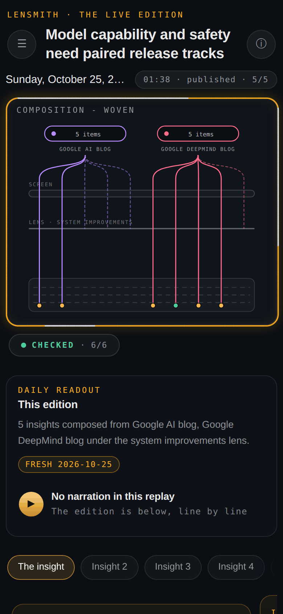
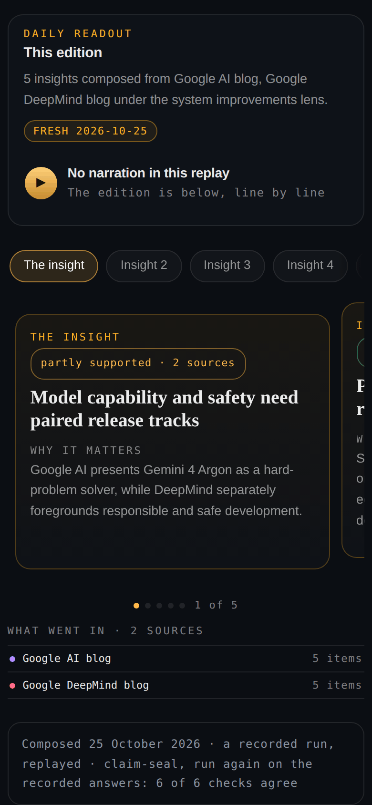
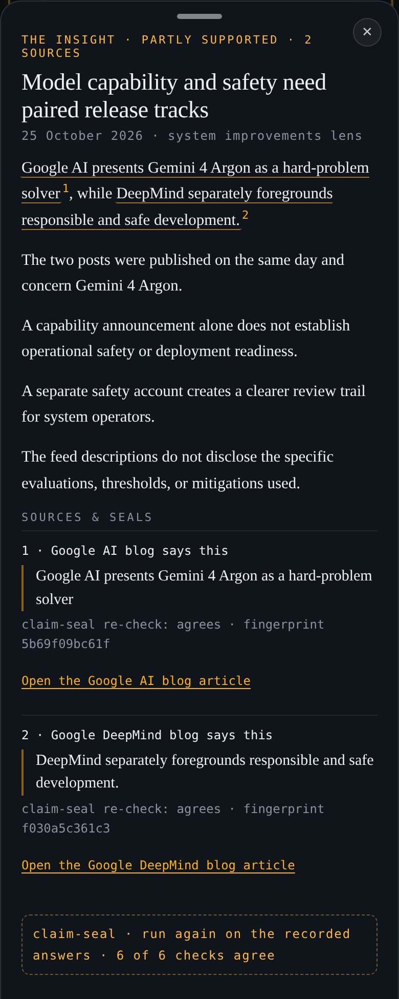

# Lensmith Composer

<table>
<tr>
<td width="33%"></td>
<td width="33%"></td>
<td width="33%"></td>
</tr>
<tr>
<td>The finished brief: five insights from six feeds, read through one lens. "Checked 6/6" means every check was made.</td>
<td>Each insight is a card you can tap. Its label says how well the cited articles back it.</td>
<td>A card, opened. Underlined words are the ones an article backs, and each source shows claim-seal's verdict.</td>
</tr>
</table>

<sub>Screenshots of the demo in <code>docs/demo</code>, which replays a brief recorded on 2026-11-02. Every word in them is from that brief.</sub>

> **AI;DR (AI, didn't read)**
> Claude wrote this code and this README. I haven't read either line by line.
> What people have checked: the private version of Composer writes briefs I read, and I click through to the cited articles to see that what a claim says is really there.
> What tools have checked, for this repository: 525 offline tests pass on Python 3.10 and 3.13 in clean containers; the commands in this README were run there (the compose command, which needs a key, on 3.13 only); a secret scanner (gitleaks) found nothing in any commit; one test fails if private names, server paths or key shapes appear anywhere in the files or the history; and a security review on 2026-11-01 attacked it as a hostile feed, a hostile web page and a hostile network would, and fixed what it found, and a second reviewer attacked those fixes (see [SECURITY.md](SECURITY.md)).
> What was checked live: one brief, written from a fresh install in a clean Python 3.13 container with a real Anthropic key and the default model. It made 7 calls in 29 seconds and cost about 8 cents; every insight got a claim-seal verdict and the seal verified. The OpenAI-compatible path has not been run live; it is tested against the documented request and reply shapes only. Treat it as a working experiment, and open an issue if something's off. (Arya)

**Composer reads a few feeds, writes a short brief through a lens you choose, and checks every
claim against the article it cites before you read it.**

A lens is a few words of your own, such as "what this means for small teams" or "where the
risks are". Composer asks a model for five short insights through that lens. Each insight must
cite the feed items it uses by their exact titles. Then [claim-seal](https://github.com/lensmith-ai/claim-seal)
checks each one: a cited title must really be in the feed (plain code, no model), and then a
model reads the claim next to its source and says whether the source supports it, partly
supports it, or does not. Each insight is printed with that label, a link to each article, and
the exact words in our sentence that each article backs.

What it does not do: it does not prove a claim is true. It checks whether the cited source
backs it. A claim that a wrong source supports still passes. The checker is a model and can be
wrong; claim-seal keeps it honest where code can (a quote must be found exactly, a failed call
is "not checked", never a pass), but it cannot make the reading correct.

## Quickstart (on your computer)

You need Python 3.10 or newer. Download or clone this repository, then work from its folder.

**See it work with no key and no install.** This replays a brief composed on 2026-11-02 from
the six bundled feeds. It makes no network request and no model call:

```sh
python3 -m composer demo
```

**Install it** (in a virtual environment). `pip install .` fetches claim-seal from GitHub at a
pinned commit and checks its SHA-256, so this step needs the internet (but not git):

```sh
python3 -m venv .venv
. .venv/bin/activate
pip install .
composer demo --fast
python -m unittest discover -s tests -t tests
```

**Compose your own brief.** Set `ANTHROPIC_API_KEY` in your environment (from the Anthropic
Console), then name the sources and your lens:

```sh
composer compose --sources google-ai,deepmind --lens "system improvements" --out brief
```

It prints each step and then the brief, and writes three files to the `--out` folder (without
`--out`, a new folder under `briefs/`): `edition.json` (the brief), `check.json` (claim-seal's
full result, with the sealed rows) and `index.html` (the brief as a web page). Any lens works:
try `--lens "what this means for small teams"`. `--reading-level plain|standard|technical` sets how the brief is
written (the level is a rule in the prompt, and `plain` is also checked on the answer). All the options:

```sh
composer compose --help
```

## Install the app (setup.sh)

The full app (the phone-width page, saved briefs, a daily brief, optional narration) installs into ONE folder,
`~/.lensmith-composer`, and touches nothing else: no shell profile, no PATH, no sudo, no global Python.

```sh
./setup.sh
~/.lensmith-composer/bin/composer up        # then open http://127.0.0.1:8765/
```

`./setup.sh` checks everything first and writes nothing until every check passes. It uses your Python 3.10+ (or,
only if you say yes, downloads a pinned, checksum-verified uv into that folder, which brings its own Python), makes
a private environment there, and asks, one question at a time: your model provider and key (typed without being
shown, stored in a file only you can read), starting sources, optional narration (it shows the size and the
licences first, and reuses a Kokoro you already have, read-only, when it passes a check), an optional article
parser for news pages without a feed, a daily brief, and a port. In the app you can add a source by pasting a blog's
address (it finds the feeds and you pick one), start from a package of sources, and make and edit your own lenses
(name, what to look for, register, reading level; each edit is a new revision, and a brief records the one it
used). `./setup.sh --answers answers.toml` asks nothing. `composer doctor` checks the install one line at a time;
`composer uninstall` removes what setup made and keeps your briefs unless you add `--delete-data`. Composer works
only in folders no other account can change; if setup refuses yours (a home reached through a link, as on Fedora
Silverblue; a group-writable folder under umask 002; a FAT or exFAT disk), the refusal says what to do, and
[docs/setup.md](docs/setup.md) lists the common cases. Everything, including updates, backups and what each command
may touch: [docs/setup.md](docs/setup.md).

## Bring your own model

Composer calls the model with your own key. Nothing goes through any other service.

| setting | what it does |
|---|---|
| `ANTHROPIC_API_KEY` | your Anthropic key (the default provider) |
| `COMPOSER_MODEL` | the model id; default `claude-sonnet-5-5` |
| `COMPOSER_PROVIDER` | `anthropic` (default) or `openai` for any OpenAI-compatible endpoint |
| `COMPOSER_OPENAI_BASE_URL` | for `openai`: the endpoint, such as `https://api.openai.com/v1` or a local server |
| `OPENAI_API_KEY` | for `openai`: the key |
| `COMPOSER_MAX_TOKENS` | the reply ceiling per call (default 16000) |
| `COMPOSER_ANTHROPIC_FALLBACK` | `off` turns off the API's server-side refusal fallback, which is on by default for the models that accept it |
| `COMPOSER_CHECKER_PROVIDER` | optional: `anthropic` or `openai` for a separate model that checks the claims (unset: the writer checks) |
| `COMPOSER_CHECKER_MODEL`, `COMPOSER_CHECKER_OPENAI_BASE_URL` | that checker's model id and, for `openai`, its endpoint |
| `COMPOSER_CHECKER_API_KEY` | that checker's key (never the writer's key) |

`composer setup` offers a short list of model ids for the service you choose (`composer/data/models.json`;
`claude-sonnet-5-5` stays the default), makes one tiny test call per key that says plainly what is wrong if it
fails, and can name a separate model to check the claims ([docs/setup.md](docs/setup.md)).

The key is read when each call is made. It is never logged or printed. The command line never stores it; the
installed app stores it only if you give it to `composer setup`, in a file only you can read (mode 0600).

## Three ways to run it

1. **Local (your computer, your key).** The command line above. Briefs land in `briefs/`.
2. **Static demo (no key, no server).** `docs/demo/` replays the recorded brief in a window onto
   Composer's own screen: the compose sentence, the sources being read, the sand-and-words
   animation through each step, the weave, then the finished edition, where each card opens to
   show which of its words each article backs. `docs/demo/brief.html` is the same brief as a plain
   page. Host the `docs/` folder on any static host (GitHub Pages works), open
   `docs/demo/index.html` from disk, or serve it on your own computer and open
   http://127.0.0.1:8000/ :

   ```sh
   python3 -m http.server 8000 --bind 127.0.0.1 --directory docs/demo
   ```

   On a laptop the phone stands in the middle of the page, with what you are looking at beside
   it; on a phone it fills the screen. It makes no outside request and calls no model; with
   reduced motion it shows the finished edition. Rebuild the folder with:

   ```sh
   composer demo --site docs/demo
   ```

3. **The app, always on (your key, your machine or server).** `composer up` (after `./setup.sh`, above) runs the
   full app on 127.0.0.1:8765 with its engine, optional narration and the daily brief. The 0.1 `composer serve`
   below still works: it shows the latest
   brief as a plain page (the one `docs/demo/brief.html` shows, not the phone replay) and a form
   to compose a new one. It listens on 127.0.0.1:8765 by default; open http://127.0.0.1:8765/ .
   Without a key it still shows the recorded brief, and Compose says that a key is needed.
   Other web sites open in your browser cannot use it: it answers only requests addressed to
   127.0.0.1 or localhost, and only its own page can start a brief.

   ```sh
   composer serve
   ```

   To let other machines reach it, set `COMPOSER_SERVER_PASS` to a long phrase first and start
   it with `--host 0.0.0.0`; it refuses to listen beyond this machine without one, because
   anyone who can compose spends your API credit. Put a TLS proxy in front of it. One brief runs
   at a time.

   To run it on a server with HTTPS and a login, use the container image with Docker Compose and Caddy:
   [docs/deploy-vps.md](docs/deploy-vps.md) walks through it step by step, with a trial on your own computer first.

## To get this every day

Pick one of three:

1. **Your laptop.** Turn on the daily brief (`./setup.sh` asks; later, `composer setup --reconfigure schedule`). It
   runs only while `composer up` runs and that computer is awake, and you read it on that computer.
2. **Your own server with a domain.** Always on, and you can read it from anywhere, on any device. The container
   image, Caddy for HTTPS and one login: [docs/deploy-vps.md](docs/deploy-vps.md).
3. **No setup.** Sign up on [lensmith.ai](https://lensmith.ai) to get the daily brief by email.

## What a brief costs

**7 model calls** with the default settings: 1 to write the brief, 1 to check each of the 5
insights, and 1 to check the connection the brief draws between sources. If the first answer
cannot be used (not valid JSON, or a citation outside the chosen sources), Composer asks once
more, which makes 8. Fetching a feed costs nothing; it is one request each.

**Measured: about $0.08 per brief** with the default model. One live brief (the command above,
Google AI blog and Google DeepMind blog, 5 items each, on 2026-11-01) made 7 calls to
`claude-sonnet-5-5` and the API reported 14,334 input and 4,679 output tokens: 1,910 in and
2,594 out to write the brief, and about 2,000 to 2,300 in and 300 to 450 out for each of the
6 checks. At Anthropic's published prices for Claude Sonnet 5.5, $2 per million input tokens
and $10 per million output tokens ([pricing page](https://platform.claude.com/docs/en/about-claude/pricing),
read 2026-11-01), that is $0.0287 + $0.0468 = **$0.0755**. It took 29 seconds from start to finish.
Your cost moves with the number of sources and items, the model, and whether a retry is needed;
each brief's `edition.json` records its own calls and the token counts the API reported.

**A separate checker is optional.** By default the model that writes the brief also checks it. You can name a
second model for the checks (`composer setup` asks; or the `COMPOSER_CHECKER_*` settings above): the writer then
makes the 1 write call and the checker the 6 check calls, each billed at its own model's price, and the brief's
receipts list the two models separately. A different model can catch mistakes the writer shares with itself; it
does not make the check infallible.

The recorded demo brief was written and checked by gpt-5.6-terra (an OpenAI model) on a
flat-rate plan, with the same pipeline but not through this repository's API layer: 7 calls,
41,111 input and 5,183 output tokens. Its token counts are not comparable with Claude's.

## Adding your own sources

Yes: any RSS or Atom feed, the Hacker News front page, or a news page with no feed. Add one with
`composer sources add` (it writes `composer-sources.json` in the current folder) and use its id
in `--sources`. See [docs/adding-sources.md](docs/adding-sources.md) for the file format, the
three kinds of source and their safety rules. To see what is available:

```sh
composer sources list
```

## What is kept, and what is not

- The brief (`edition.json`, `index.html`) keeps the brief's own words, the cited article titles
  and links, the verdicts, and SHA-256 fingerprints of the passages checked. It does not store
  the articles' text. Like any summary, a sentence may quote a few words of a title or
  description.
- `check.json` is claim-seal's full record: verdicts, the sealed claim-evidence rows (positions
  and digests, never source text) and the judge model's one-line reasons. Those reasons often
  quote the source, so read `check.json` before you share it.
- The feed text is held in memory for the one brief. `--keep-sources` saves it, for debugging.
- The recorded demo brief (`composer/data/recorded-run.json`) follows the same rule.

## Sources and your responsibility

Composer reads the sources **you** choose and writes a brief in a model's own words. When you run your own copy,
you are the publisher of what it writes. Before you share a brief, please:

- **Check the source's terms.** Some sites forbid automated reading, reuse or AI use in their terms of use or
  `robots.txt`. A public feed is an invitation to read, not a licence to republish.
- **Do not get around paywalls or log-ins.** Composer sends no cookies or log-ins, and you should not add sources
  that need them.
- **Link, credit and keep quotes short.** Every insight already links to its article. If you quote a source, use
  quotation marks, name it (and its author), and keep each quote short. We use at most 25 words per quote, at most
  two quotes from one article per brief, and never the article's opening sentence. Composer asks its writer for
  its own words and checks every brief against these limits before it is shown; a brief that breaks them is
  rewritten once, or the parts that break them are dropped, and the brief's receipt says so.
- **Do not use logos or images** from a source; name it in plain text.
- **Say it was written by AI.** Every brief page and the app show the line "AI-written summary; check the source."
  Keep it on anything you publish. The model can get things wrong, and claim-seal's check is a model too. In the
  EU, publishing AI-written text about matters of public interest without saying so can break the AI Act
  (Article 50), unless a person reviews it and takes editorial responsibility.
- **Think twice before publishing a claim marked "not supported"**, especially about a named person or company.
  You are the publisher of what your copy writes.
- **Fix and remove fast.** If you publish briefs, give publishers and readers a way to reach you, and act on
  corrections and removal requests.
- **`html-index` sources read web pages, not feeds.** Composer does not check a site's `robots.txt` yet; check it
  yourself before you add a page like that.

The six bundled sources are public feeds: the Google AI blog, the Google DeepMind blog, the Hugging Face blog, the
Microsoft Research blog, the PyTorch blog, and arXiv's daily cs.AI listing (titles and abstracts, which arXiv offers
under CC0). Composer keeps a short excerpt of each item and never stores or re-serves a post's full text. Bundling a
feed is not an endorsement by its publisher, and no publisher has reviewed Composer.

Composer is MIT-licensed and comes with no warranty (see [LICENSE](LICENSE)). The licence covers the code; it gives
you no rights to anyone else's articles. This section is guidance, not legal advice.

## What is in this repository

| path | what it is |
|---|---|
| `composer/adapters/` | the three source readers: `rss_or_atom`, `hn_json_api`, `html_index` |
| `composer/sanitize.py` | cleans feed text before it reaches a prompt |
| `composer/prompt.py` | the writing prompt and the check on the model's answer |
| `composer/providers.py` | the model layer: Anthropic Messages API and OpenAI-compatible endpoints |
| `composer/pipeline.py` | one brief from start to finish |
| `composer/cli.py`, `composer/server.py` | the `composer` command, `composer up` and `composer serve` |
| `setup.sh`, `composer/installer.py`, `composer/home.py` | the install: its checks, its questions, the app folder and its manifest |
| `composer/narration/` | optional narration: detection, the read-only reuse check, the hash-locked runtime, the worker |
| `composer/doctor.py`, `composer/lifecycle.py`, `composer/scheduler.py` | doctor; backup, restore, update, rollback, uninstall; the daily brief |
| `composer/page.py`, `composer/web/` | the one-file brief page |
| `composer/window.py`, `composer/web/window/` | the animated replay window and its scripts and styles |
| `composer/sources.json` | the six bundled feeds |
| `composer/data/recorded-run.json` | the recorded brief the demo replays |
| `docs/demo/` | the static demo: the animated replay (`index.html`) and the plain page (`brief.html`) |
| `tests/` | offline tests: fixtures only, no network, no key |
| `Dockerfile`, `compose.yaml`, `Caddyfile` | the container image and the always-on setup ([docs/deploy-vps.md](docs/deploy-vps.md)) |
| `tests/deploy/proof.sh` | the always-on proof: HTTPS through Caddy with the login, the app port closed, a backup restored |
| `scripts/release/` | the release build (sdist, wheel, SBOM, checksums), release candidates (`rc.py`) and the claim-sealed release note |
| `.github/workflows/` | tests on Linux, macOS and Windows, the scans, the nightly proof, and the release |

## Privacy

Composer has no telemetry: no analytics, no crash reports, no update checks. It talks to the feeds you chose and
the model provider you chose, with your key, and nothing else. On a server, Caddy also talks to its certificate
authority.

## Releases you can check

Each release lists SHA256SUMS for its files, a CycloneDX SBOM of what the package installs (optional narration
parts listed with their licences), and GitHub artifact attestations for every file and the container image, so
`gh attestation verify` can show which workflow and commit built it. The release note's factual lines are checked by
claim-seal against CHANGELOG.md and the recorded test results before it is published. See
[docs/releasing.md](docs/releasing.md).

## Tests

Every test runs offline, from invented fixture feeds and scripted model replies. The model
layer is tested with a scripted transport, and the whole pipeline (fetch, screen, write, check,
seal) runs end to end with claim-seal replaying recorded judge answers. Without claim-seal
installed, the 8 pipeline tests are skipped and the rest still run.

```sh
python -m unittest discover -s tests -t tests
```

`tests/test_banned.py` fails if the working tree or the git history holds a server path, an
internal id shape, a key shape, or one of a list of private names (stored as salted hashes). To
add your own terms without publishing them, point `COMPOSER_DENYLIST` at a file outside the
repository, one regular expression per line.

## Licence

MIT, see [LICENSE](LICENSE). claim-seal is MIT. See [THIRD-PARTY.md](THIRD-PARTY.md) for every
dependency, its version and its licence.
